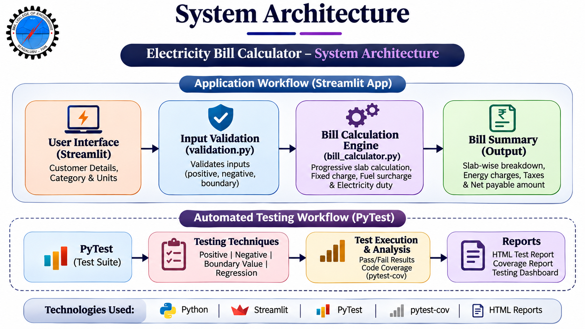
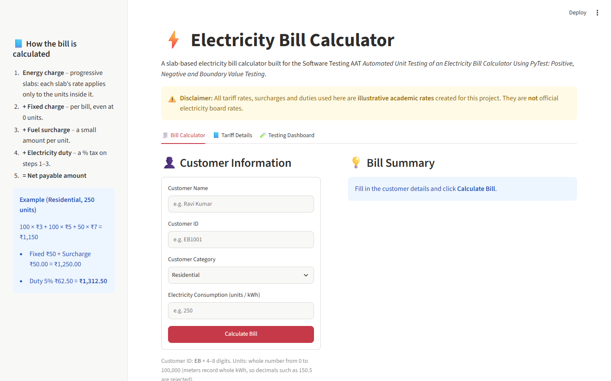
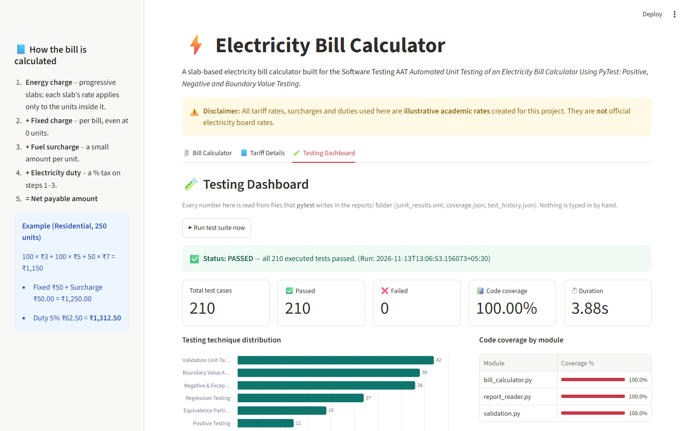

# Automated Unit Testing of an Electricity Bill Calculator Using PyTest
### Positive, Negative and Boundary Value Testing — Software Testing AAT

---

## 1. Introduction
This project is a Python **Electricity Bill Calculator** with a **Streamlit** web dashboard, verified by an **automated PyTest suite of 210 test cases** across ten testing techniques, with **code coverage** from pytest-cov and **HTML reports** from pytest-html. A built-in **Testing Dashboard** shows the real results of the latest test run.

> ⚠️ All tariff rates, surcharges and duties are **illustrative academic values** created for this project. They are **not** official electricity board rates.

## 2. Problem Statement
Electricity bills use slab-based (progressive) tariffs, and then add fixed charges, surcharges and taxes. Errors at slab edges (e.g. 100 vs 101 units), rounding mistakes in tax, or wrong handling of invalid input (negative units, text, empty values) produce incorrect bills. Manual checking is slow and error-prone, so the calculation must be verified by **automated, repeatable tests**, and every change must be re-checked (**regression testing**).

## 3. Objectives
1. Build a modular slab-based bill calculator for **Residential** and **Commercial** customers with configurable **fixed charges, fuel surcharge and electricity duty**.
2. Validate all customer inputs with clear error messages.
3. Verify correctness using **Positive, Negative, Boundary Value, Equivalence Partitioning, Parameterized, Exception, Regression and Integration testing**.
4. Measure **code coverage** and generate HTML test and coverage reports.
5. Show **real** test results in a Streamlit **Testing Dashboard**.

## 4. Technologies Used
| Tool | Purpose |
|---|---|
| Python 3.10+ (tested on 3.11.9) | Programming language |
| PyTest 9.2 | Testing framework |
| pytest-cov 7.1 | Code coverage (terminal, HTML, JSON) |
| pytest-html 4.2 | Detailed HTML test execution report |
| Streamlit 1.67 (+ Altair, pandas) | Web dashboard and chart |
| Python `decimal` module | Exact money rounding (paise) |
| VS Code | Development environment |

## 5. Tariff Structure (Illustrative)
| Slab (units) | Residential (₹/unit) | Commercial (₹/unit) |
|---|---|---|
| 0 – 100 | 3 | 6 |
| 101 – 200 | 5 | 7 |
| 201 – 300 | 7 | 8 |
| Above 300 | 8 | 9 |
| **Fixed charge / bill** | **₹50** | **₹100** |
| **Fuel surcharge** | **₹0.20 / unit** | **₹0.30 / unit** |
| **Electricity duty** | **5 %** | **8 %** |

**Bill formula**
```
Energy charge = sum of (units in each slab × slab rate)
Subtotal      = Energy charge + Fixed charge + (Units × Fuel surcharge rate)
Duty          = Subtotal × Duty %          (rounded to paise, half-up)
Net payable   = Subtotal + Duty
```
**Worked example (Residential, 250 units):**
100×3 + 100×5 + 50×7 = ₹1,150 → + ₹50 fixed + ₹50.00 surcharge = ₹1,250.00 → + 5% duty ₹62.50 = **₹1,312.50**

Every value is configured in one place: the `TARIFFS` dictionary in `bill_calculator.py`.

### Input handling
| Input | Behaviour |
|---|---|
| **0 units** | Accepted. Energy charge 0; the fixed charge and the duty on it still apply (₹52.50 Residential). |
| **Decimal units** (150.5) | Rejected: meters record whole kWh. `150.0` is accepted as 150. |
| **Negative units** | Rejected: "Units cannot be negative." |
| **Very high units** | Accepted up to 100,000; above that, rejected. |
| **Text / empty / None** | Rejected with a specific message. |
| **Customer ID** | `EB` + 4–8 digits (e.g. `EB1001`), case-insensitive. |
| **Customer name** | 2–50 characters; letters, spaces, dots. |
| **Category** | `Residential` or `Commercial`, case-insensitive. |

## 6. System Architecture



```
 ┌───────────────────────────────┐  inputs   ┌────────────────────────┐ validated ┌──────────────────┐
 │ app.py (Streamlit)            │ ────────► │ bill_calculator.py     │ ◄──────── │ validation.py    │
 │  Tab 1 Bill Calculator        │ ◄──────── │ generate_bill()        │ values /  │ validators +     │
 │  Tab 2 Tariff Details         │ bill dict │ slabs, surcharge, duty │ exceptions│ custom exceptions│
 │  Tab 3 Testing Dashboard ─┐   │           └────────────────────────┘           └──────────────────┘
 └───────────────────────────│───┘                     ▲                                  ▲
                             │ reads               tests/ (PyTest, 210 cases) ─────────────┘
                             ▼                           │ writes
                    report_reader.py  ◄──── reports/ (junit XML, coverage JSON/HTML, HTML report, history)
```
The business logic is kept out of the UI, so it can be unit-tested directly.

## 7. Modules and Functionalities
| Module | Main functions | Responsibility |
|---|---|---|
| `validation.py` | `validate_units`, `validate_customer_name`, `validate_customer_id`, `validate_category` | Clean and validate inputs. Raise `InvalidUnitsError`, `InvalidCustomerError` or `InvalidCategoryError`, all subclasses of `BillValidationError`. |
| `bill_calculator.py` | `calculate_slab_charges`, `calculate_energy_charge`, `calculate_total_bill` (base bill), `calculate_charges`, `calculate_net_bill`, `generate_bill`, `to_money` | Tariff configuration and all bill calculations |
| `report_reader.py` | `load_junit_results`, `load_coverage`, `load_history`, `technique_distribution` | Reads real pytest output files for the dashboard. Returns "no data" when they are missing, never fake numbers. |
| `app.py` | — | Streamlit UI: three tabs, form, breakdown tables, Testing Dashboard with a "Run test suite now" button |
| `tests/conftest.py` | `pytest_terminal_summary` hook | Appends each real run's counts to `reports/test_history.json` |

## 8. Folder Structure
```
Electricity_Bill_PyTest_Project/
├── app.py                  # Streamlit dashboard (3 tabs)
├── bill_calculator.py      # Tariff config + slab, surcharge, duty calculation
├── validation.py           # Input validators + custom exceptions
├── report_reader.py        # Reads pytest reports for the Testing Dashboard
├── requirements.txt
├── pytest.ini              # Coverage, reports, markers
├── README.md
├── tests/
│   ├── __init__.py
│   ├── conftest.py            # Records run history
│   ├── test_positive.py       # Positive testing
│   ├── test_negative.py       # Negative + exception testing
│   ├── test_boundary.py       # Boundary value analysis (+ high consumption)
│   ├── test_equivalence.py    # Equivalence partitioning
│   ├── test_validation.py     # Validator unit tests
│   ├── test_taxes.py          # Surcharge, duty, rounding, configurability
│   ├── test_regression.py     # Frozen v1 baseline
│   ├── test_integration.py    # Validation + calculation together
│   ├── test_report_reader.py  # Dashboard reader correctness
│   └── test_app.py            # Streamlit UI tests (AppTest)
└── reports/                # Generated by every pytest run
    ├── test_report.html       # Detailed HTML test execution report
    ├── coverage_html/index.html
    ├── coverage.json
    ├── junit_results.xml
    └── test_history.json
```

## 9. Testing Techniques
| Technique | File | Tests | What is verified |
|---|---|---|---|
| Positive testing | `test_positive.py` | 12 | 50, 100, 150, 250, 500 units; full bill fields |
| Negative + Exception testing | `test_negative.py` | 38 | Negative, text, empty, `None`, bad category/ID, decimals, NaN. Checks the exception **type and message**. |
| Boundary value analysis | `test_boundary.py` | 39 | 0, 1, 99–101, 199–201, 299–301 (energy **and** net bill), Commercial boundaries, high values 1,000 / 5,000 / 99,999, −1, MAX, MAX+1 |
| Equivalence partitioning | `test_equivalence.py` | 19 | Valid / negative / non-numeric / empty partitions; equivalent input formats |
| Validator unit tests | `test_validation.py` | 42 | Each validation function on its own |
| Tax & surcharge testing | `test_taxes.py` | 11 | Surcharge, duty, half-up rounding to paise, configurable rates |
| Regression testing | `test_regression.py` | 27 | Version 1 results, rates, data format and bill fields are unchanged after the upgrade; tariff configuration is complete and consistent (guards against the `KeyError: 'fuel_surcharge_per_unit'` bug) |
| Integration testing | `test_integration.py` | 7 | Validation + calculation together; calculation never runs on invalid input; components add up |
| Dashboard reader tests | `test_report_reader.py` | 9 | Correct counts; missing or corrupt files give "no data" |
| Frontend (UI) tests | `test_app.py` | 6 | Tabs load, ₹1,312.50 shown, errors shown, Tariff Details shows surcharge and duty, dashboard renders |
| **Total** | | **210** | |

- **Parameterized testing:** `@pytest.mark.parametrize` is used throughout, so one test function checks many inputs.
- **Exception testing:** `pytest.raises(InvalidUnitsError, match="cannot be negative")` checks both the exception class and its message.
- **Independent verification:** every expected value is hand-calculated (working shown in comments), never computed by the code under test.
- **Markers:** run any technique on its own with `-m positive / negative / boundary / equivalence / validation / taxes / regression / integration / reports / frontend`.

## 10. Test Case Examples
| ID | Technique | Input | Expected result |
|---|---|---|---|
| TC01 | Positive | 250 units, Residential | Energy ₹1,150, base ₹1,200, net **₹1,312.50** |
| TC02 | Positive | 250 units, Commercial | Net **₹2,025.00** (1,875.00 + 8% 150.00) |
| TC03 | Boundary | 100 units | Energy ₹300, net ₹388.50 |
| TC04 | Boundary | 101 units | Energy ₹305 (1 unit at ₹5), net ₹393.96 |
| TC05 | Boundary | 301 units | Energy ₹1,508, net ₹1,699.11 |
| TC06 | Boundary | 0 units | Net ₹52.50 (fixed + duty only) |
| TC07 | High value | 99,999 units | Net ₹8,60,098.89 |
| TC08 | Boundary | 100,001 units | `InvalidUnitsError`: "cannot exceed 100,000" |
| TC09 | Negative | −50 units | `InvalidUnitsError`: "cannot be negative" |
| TC10 | Negative | "abc" | `InvalidUnitsError`: "must be numeric" |
| TC11 | Negative | "" / None | `InvalidUnitsError`: "cannot be empty" |
| TC12 | Negative | 150.5 units | `InvalidUnitsError`: "whole number" |
| TC13 | Negative | Category "Industrial" | `InvalidCategoryError` |
| TC14 | Negative | Customer ID "1234" | `InvalidCustomerError` |
| TC15 | Tax rounding | 7 units Commercial | duty 11.528 → ₹11.53, net ₹155.63 |
| TC16 | Regression | 777 units Residential | Energy ₹5,316 (unchanged from v1) |
| TC17 | Integration | " eb4321 ", " 301 " | Cleaned to EB4321 / 301, net ₹1,699.11 |

### Boundary value table (Residential)
| Units | Energy | Subtotal (+50 fixed + 0.20/unit) | Duty 5% | Net payable |
|---|---|---|---|---|
| 0 | 0 | 50.00 | 2.50 | 52.50 |
| 1 | 3 | 53.20 | 2.66 | 55.86 |
| 99 | 297 | 366.80 | 18.34 | 385.14 |
| 100 | 300 | 370.00 | 18.50 | 388.50 |
| 101 | 305 | 375.20 | 18.76 | 393.96 |
| 199 | 795 | 884.80 | 44.24 | 929.04 |
| 200 | 800 | 890.00 | 44.50 | 934.50 |
| 201 | 807 | 897.20 | 44.86 | 942.06 |
| 299 | 1493 | 1602.80 | 80.14 | 1682.94 |
| 300 | 1500 | 1610.00 | 80.50 | 1690.50 |
| 301 | 1508 | 1618.20 | 80.91 | 1699.11 |

## 11. Installation (Windows PowerShell)
```powershell
cd "C:\Users\S Manisha Rani Patra\Electricity_Bill_PyTest_Project"
python -m venv .venv
.\.venv\Scripts\python.exe -m pip install -r requirements.txt
```
(The `.venv` already exists and is installed on this machine.)

## 12. Execution
```powershell
# Run the web app (http://localhost:8501)
.\.venv\Scripts\python.exe -m streamlit run app.py

# Run ALL tests (also generates all reports)
.\.venv\Scripts\python.exe -m pytest

# Run one technique
.\.venv\Scripts\python.exe -m pytest -m boundary
.\.venv\Scripts\python.exe -m pytest -m regression
.\.venv\Scripts\python.exe -m pytest -m integration

# Run one file
.\.venv\Scripts\python.exe -m pytest tests\test_taxes.py
```

## 13. Test Reports
Every `pytest` run produces:
| Report | Location | Contents |
|---|---|---|
| Terminal summary | console | Each test PASSED/FAILED, totals, coverage table |
| HTML test report | `reports\test_report.html` | Totals, passed, failed, duration, every individual test |
| HTML coverage report | `reports\coverage_html\index.html` | Line-by-line coverage per module |
| JUnit XML | `reports\junit_results.xml` | Machine-readable results (read by the dashboard) |
| Coverage JSON | `reports\coverage.json` | Coverage % (read by the dashboard) |
| Run history | `reports\test_history.json` | Last 20 runs (read by the dashboard) |

```powershell
start reports\test_report.html
start reports\coverage_html\index.html
```
**Testing Dashboard tab** shows: total / passed / failed, PASSED/FAILED status, coverage %, technique distribution chart, filterable individual results, recent executions, and a download button for the HTML report. The **▶ Run test suite now** button runs pytest live and refreshes the dashboard with the new results.

## 14. Code Coverage (actual result)
```
Name                 Stmts   Miss  Cover
----------------------------------------
bill_calculator.py      67      0   100%
report_reader.py        62      0   100%
validation.py           60      0   100%
----------------------------------------
TOTAL                  189      0   100%
============================= 210 passed =============================
```
Coverage is measured on the logic modules. The Streamlit UI (`app.py`) is verified separately by the `test_app.py` UI tests.

### Troubleshooting: `KeyError: 'fuel_surcharge_per_unit'`
This error appears when a Streamlit server **started before the tariff upgrade** is still running. It keeps the old `bill_calculator` module in memory while showing the new `app.py`. Stop the server (`Ctrl+C`) and start it again. The configuration is now checked at startup by `check_tariff_config()`, and regression tests in `test_regression.py` and `test_app.py` fail if any tariff key is missing.

## 15. Conclusion
The upgraded calculator adds configurable fuel surcharge and electricity duty with exact paise rounding, while keeping the original slab logic unchanged. The regression suite proves this. The system is verified by 210 automated PyTest cases across ten techniques, and all of them pass. Boundary value analysis covers every slab edge for both the energy charge and the final payable amount, and also very high consumption. Negative, equivalence and exception tests prove that invalid input is rejected with specific errors. Integration tests prove the validation and calculation modules work together safely. pytest-cov reports 100% statement coverage of the logic modules. The Streamlit Testing Dashboard shows these results directly from the real pytest output files, so nothing is fabricated.

## Screenshots

Bill Calculator tab:



Testing Dashboard tab (numbers read from the real pytest output in `reports/`):


